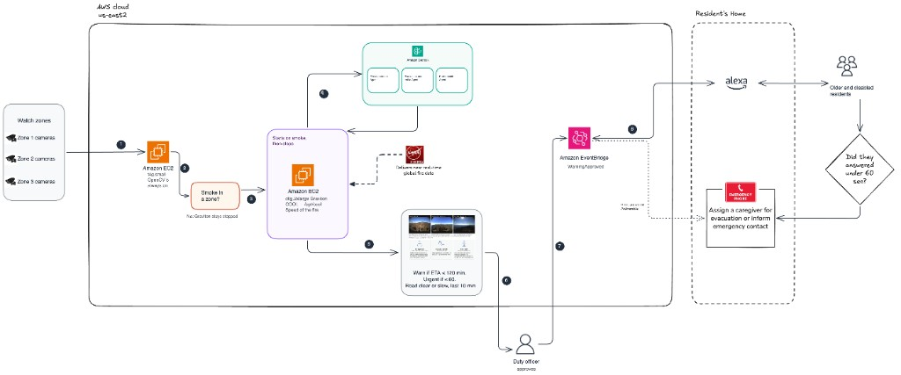
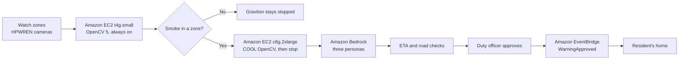

# FireCouncil

A wildfire warning copilot. OpenCV on AWS turns public camera frames into a warning a person approves before anyone is told. The warning is for older and disabled residents. The system is advisory only. It never issues an evacuation order.

This repository is the OpenCV AI Competition 2026 entry (powered by AWS).

**Deadline:** Monday, October 26, 2026, 11:45 pm PDT.
**Rules:** https://opencv26.devpost.com/
**Awards targeted:** Grand prizes, Agentic Vision Award, Best Use of COOL Award.
**Live page:** http://3.14.133.75:8080/

The address changes if that instance is stopped and started. There is no Elastic IP.

## What the running page does

Zones on the page are **demo zones, not official.** Camera frames are from HPWREN (hpwren.ucsd.edu): three views of the Fairview Fire, September 5, 2022 (Santa Margarita, Boucher Hill looking north, Toro Peak looking west). The saved decision file is the Norte replay. Residents in the repo are synthetic.

1. **See.** The always-on box, a `t4g.small` in `us-east-2`, runs OpenCV 5 from pip (`opencv-python-headless==5.0.0.93`). Smoke on any of the three cameras is enough to mark the clip. The page stays blank until that clip finishes.
2. **Speed.** Plume speed and bearing come from the camera frames, not from a number typed into the replay file. The Fairview Santa Margarita clip measures about 6.6 km/h, moving east. The NASA FIRMS line on the card is a saved hotspot file. The page does not call NASA.
3. **COOL, only when smoke is marked.** If `GRAVITON_LAUNCH=1`, that smoke mark starts one `c8g.2xlarge` from the Cloud Optimized OpenCV image for Graviton (`/opt/cool`, OpenCV 4.14.0-pre). It measures the speed, then the instance is stopped. The switch is off on the public page, so opening the page does not start it. With the switch off, the Graviton stays stopped.
4. **Decide.** Three Amazon Bedrock personas propose when `BEDROCK_CALLS=1`: fire department, evacuation and traffic, and public health. Fixed checks then have the last word:
   - Warn a zone when its ETA is 120 minutes or less and officials have not already ordered that zone out.
   - The warning is urgent when that ETA is 60 minutes or less. Otherwise it stays advisory.
   - A road counts only when it is clear or slow and the report is from the last 10 minutes. A clear road wins.
   - Care sites in those zones are named first.
   - Smoke with no ETA produces a health note only. No zone is warned.
5. **A person approves.** The duty officer approves on the page. Nothing is treated as sent before that.
6. **Record.** Approve writes the warning to a local outbox. It does not send email. When `APPROVAL_EVENTS=1`, the same approve publishes `WarningApproved` on the default Amazon EventBridge bus (`source` `firecouncil.approval`).
7. **Acknowledge.** If a resident is marked vulnerable and does not answer within `ACK_WINDOW_SECONDS` (60 in this demo), the check returns their caregiver's email. A resident who answers, and a resident who is not marked vulnerable, are not escalated. That check is not wired to the approve button. Alexa is the intended speaker in the home. There is no live Alexa skill.

`KILL_SWITCH=true` stops the outbox write.

## COOL compared with ordinary OpenCV

Same check the page runs, on the three Fairview cameras, eight frames each. Median of three passes after a warmup. Smoke is marked on the same frame on every machine. COOL does not see the fire earlier. The difference is computer time.

| Machine | OpenCV | vCPU | Time for 3 cameras | 1,000 cameras, one after another |
|---|---|---|---|---|
| Demo EC2, `t4g.small` | pip 5.0.0 | 2 | 1.069 s | 356 s |
| Same size as COOL, `c8g.2xlarge` | pip 5.0.0 | 8 | 0.512 s | 171 s |
| COOL image, `c8g.2xlarge` | 4.14.0-pre from `/opt/cool` | 8 | 0.482 s | 161 s |

First mark in the footage, identical on all three:

- Boucher Hill: 60 seconds into the clip, frame 2
- Santa Margarita: 121 seconds, frame 3
- Toro Peak: 122 seconds, frame 3

On the same `c8g.2xlarge`, COOL finishes these three cameras 0.03 seconds sooner than ordinary OpenCV. Across 1,000 cameras done one after another, that gap is about 10 seconds of computer time. Against the small demo box the gap is about 3 minutes, and most of that is the bigger machine. This timing does not add alerts or a count of people reached.

## Architecture





The diagram with service icons is [docs/firecouncil-current.excalidraw](docs/firecouncil-current.excalidraw). A plainer copy is [docs/cool_architecture.mmd](docs/cool_architecture.mmd).

## Repository layout

```
README.md
Makefile                        setup, test, replay, serve
PLAN.md                         earlier build plan
requirements.txt
services/
  api/                          the duty-officer page
  vision/cv/                    smoke, plume speed, route status
  vision/models/LICENSES.md     classical OpenCV only; no ONNX weights
  vision/app.py                 localhost vision API
  agents/                       personas, rules, orchestrator, Graviton start
  notify/                       local outbox and the EventBridge event
  ack/                          acknowledgement and caregiver check
data/
  replays/route_block.yaml      saved Norte decision inputs
  fixtures/firms/               saved NASA hotspot rows
  raw/figlib/                   HPWREN frames used by the page and tests
  local/                        decisions, outbox, evidence (not in git)
tests/
docs/                           diagrams, COOL check, traces
```

## Run locally

```bash
make setup
make test
make serve
```

`make serve` opens http://127.0.0.1:8080/ . Tests do not call AWS. They call Bedrock only when `BEDROCK_CALLS=1`, publish the approval event only when `APPROVAL_EVENTS=1`, and start the Graviton instance only when `GRAVITON_LAUNCH=1`.

## Configuration

Names only. Values stay in `.env`, which is not committed.

| Variable | Purpose |
|---|---|
| `AWS_REGION` | `us-east-2` |
| `BEDROCK_CALLS` | `1` lets the three personas call Bedrock |
| `PERSONA_MODEL_ID` | Bedrock model id for those personas |
| `APPROVAL_EVENTS` | `1` publishes `WarningApproved` on approve |
| `GRAVITON_LAUNCH` | `1` starts the COOL Graviton instance after smoke. Off on the public page |
| `PLUME_SPEED` | `1` uses the measured camera speed instead of the replay file |
| `KILL_SWITCH` | `true` blocks the outbox write |
| `ACK_WINDOW_SECONDS` | seconds before a vulnerable resident's caregiver is named. `60` in this demo |
| `FIRMS_MAP_KEY` | NASA FIRMS key. The page uses a saved file and does not call NASA |
